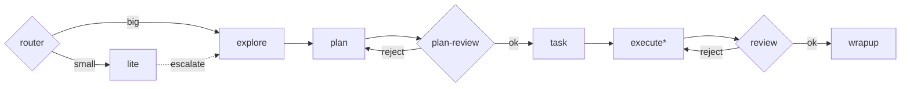

# atomic-workflow 그래프 엔지니어링 설계안

## 1. 현재 구조 → 노드/엣지
| 노드 | 입력 | 출력(아티팩트) | 현재 실행자 |
|---|---|---|---|
| explore | 요청, memory | EXPLORE.md | explorer |
| plan | EXPLORE, memory | PLAN.md | planner |
| plan-review | PLAN | 승인/반려 | plan-reviewer |
| task | PLAN | TASKS.md (worker 필드) | tasker |
| execute | TASKS 항목 | 코드 diff, run-done 기록 | worker / cli-delegate(agy·codex·claude·opencode via invoke-worker) |
| review | diff, PLAN | 승인/반려 | atomic-reviewer |
| wrapup | 결과, 테스트 | memory 기록, 요약 | tester, memory-curator |

엣지: 순차 + `plan-review→plan`, `review→execute` 반려 루프. 이미 `run-pipeline.mjs`, `run-done.mjs`, `work-status.mjs`, `invoke-worker.sh`가 있음 → 그래프화 기반 충분. lite는 단일 노드, atomic-router는 진입 분기 노드.



## 2. 옵션
**A. 선언형 그래프(graph.yaml) + run-done/work-status 상태머신 (Cursor 내부)**
- `.atomic-graph.yaml`에 노드·엣지·조건 정의, `runs/<slug>/state.json`에 현재 노드/시도횟수/결과.
- `work-status.mjs --next` 가 다음 노드와 executor를 계산, 에이전트는 그 지시만 따름.
- 장점: 기존 스킬·설치 그대로, 의존성 없음. 단점: 진짜 병렬·강제 실행은 에이전트 준수에 의존.

**B. 외부 오케스트레이터 (LangGraph 또는 Cursor SDK, Node)**
- 그래프를 코드로 실행, 노드마다 Cursor cloud agent / `invoke-worker`(agy 등)를 호출, 체크포인트·병렬·재시도 보장.
- 장점: 결정적 제어, CI/서버 실행. 단점: 새 런타임·인증·비용 관리, Cursor 채팅 UX와 분리.

## 3. 노드 executor 스키마
```yaml
nodes:
  execute:
    executor: agy            # cursor-subagent | agy | cli
    when: "task.type in ['ui','boilerplate'] && task.files <= 4"
    timeout_min: 45
    retry: { max: 1, on: [timeout, nonzero_exit] }
    fallback:
      - { executor: cursor-subagent }
      - { executor: agy }
    parallel: per_task       # TASKS 독립 항목 병렬
    checkpoint: true
  review:
    executor: cursor-subagent
    agent: atomic-reviewer
    fallback: [{ executor: agy, mode: plan }]
```
노드 설정에는 모델을 넣지 않는다. 각 executor와 부모 세션이 선택한 하네스 기본 모델을 사용한다. agy 호출은 반드시 `invoke-worker --worker agy --timeout-min ...` 경유(bare agy 금지 규칙 유지). `cli`는 codex/claude/opencode.

## 4. 동적 AGY 라우팅 규칙
1. 정책 게이트: `.cursor-atomic-workflow.json`의 `agy.{plan,implement,review}` = `never|ask|auto` 우선.
2. 작업 유형: UI·대량 보일러플레이트·문서 → agy gemini-3.1-pro / 정교한 리팩토링·리뷰 → claude-sonnet-4-6 / DB·auth·보안 → cursor-subagent(composer-2.5) 고정.
3. 비용·크기: 파일 수·예상 토큰 임계치 초과 시 저가 모델 우선, 예산 상한 시 Cursor로.
4. 실패 기반: timeout/비정상 종료/테스트 실패 → fallback 체인 다음 단계, 같은 모델 실패 2회면 그 run에서 블랙리스트. 결과는 memory에 `executor-stats`로 누적해 다음 선택에 가중치.
5. 선택 결과와 이유를 state.json·로그에 1줄 기록.

## 5. 체크포인트·병렬
- 노드 종료마다 `state.json` + 아티팩트 해시 저장 → `--resume`로 실패 노드부터 재시작.
- execute는 TASKS 의존성 DAG로 독립 항목 병렬(별도 worktree, `격리` 옵션), review 전에 join.

## 6. 마이그레이션
1. graph.yaml 스키마 + 기본 그래프(현행 동일) 추가, doctor/check 검증.
2. `work-status --next`, `run-done --result ok|reject|fail` 로 상태 전이.
3. executor 라우터(`scripts/lib/route-executor.mjs`) + fallback, invoke-worker 재사용.
4. 체크포인트/resume, TASKS 병렬.
5. (선택) 같은 graph.yaml을 읽는 외부 러너(B)를 `scripts/graph-runner.mjs`로 추가.

## 7. 권장: A 먼저, 같은 스키마로 B 확장
이미 아티팩트·스크립트가 상태머신 형태라 A 비용이 가장 낮고 Cursor UX 유지. 그래프 정의를 단일 소스로 두면 B(SDK/LangGraph) 러너는 나중에 얹기만 하면 됨.

## 8. 리스크
- 에이전트가 A의 지시를 건너뛸 가능성 → doctor/run-done 검증으로 보완.
- agy 헤드리스 행/인증 만료 → invoke-worker timeout + fallback.
- 모델 간 출력 형식 차이 → `--json-schema`로 결과 구조 강제.
- 병렬 충돌 → worktree 격리, review에서 병합.
- 비용 폭증 → 예산 상한, retry 1회 제한.
